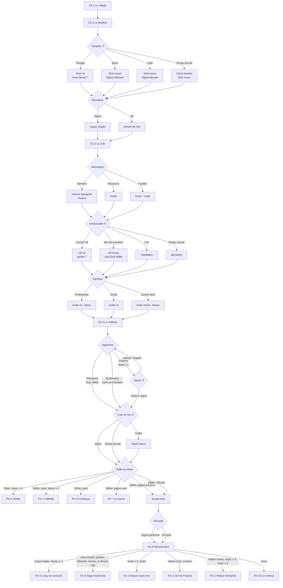

# Survivrais-tu au raid ? — Bible narrative

> Document de conception. Tout ce qui est ici est modifiable avant le code.
> Ton visé : immersif, sec, un peu d'humour noir. On ne commente jamais un choix, on en montre les suites.

---

## 1. Le pitch

An 860 et quelques. Un petit village de fjord, un jarl ambitieux, un drakkar qui part pour la Francie. Tu es une recrue sans nom sur le banc de nage. Cinq chapitres, de la hutte familiale au château franc en flammes. Ce que tu fais au village pèse au château. Personne ne te dira ce qui est juste.

**Question du jeu** : jusqu'où vas-tu pour revenir, et avec qui ?

---

## 2. Le joueur

### Origines (choix à la création)

Chaque origine donne un **trait caché** (jamais affiché), qui ouvre ou ferme des options plus tard. Aucune n'est « meilleure ».

| Origine | Trait caché | Ouvre | Ferme / coûte |
| --- | --- | --- | --- |
| **Enfant de pêcheur** | *Lit la mer* | Ch.2 : prévoir la tempête, nager pour sauver quelqu'un sans risque de blessure. Ch.5 : mener le drakkar au retour. | Ch.1 : Hakon te prend pour un rameur, pas un guerrier (réputation de départ basse). |
| **Esclave affranchi(e)** | *Parle quelques mots de franc* | Ch.3 : comprendre les moines, parler à Aude dès la rencontre (+confiance). Ch.4 : bluffer une sentinelle. | Ch.1 : Eirik te méprise ouvertement. Ch.3 : Hakon se méfie si tu parles aux captifs. |
| **Enfant de forgeron** | *Mains sûres* | Ch.2 : réparer le gouvernail. Ch.4 : forcer la porte de la salle du trésor sans bruit. | Ch.4 : tu es lent·e à escalader (chrono des remparts raccourci). |
| **Chasseur des fjords** | *Pisteur* | Ch.3 : repérer l'embuscade avant qu'elle ne se referme. Ch.4 : passer par les souterrains sans Aude. | Ch.1 : tu n'es « pas du village » ; Sigrid met plus de temps à te faire confiance. |

### Création visuelle (calques SVG)

Corps → peau → cheveux → barbe/tresses → peintures de guerre → tenue → casque → bouclier (motif + 2 couleurs) → arme. Le personnage est redessiné dans chaque scène (silhouette de dos, de profil, blessures visibles : bandeau sur le bras, boitement).

### Prénoms nordiques au hasard

Masc. : Bjorn, Leif, Torvald, Gunnar, Sten, Asgeir, Rurik, Halvard. Fém. : Astrid, Freydis, Gudrun, Thora, Ingrid, Yrsa, Solveig, Ragna. Neutres possibles : Ask, Embla, Rune.

---

## 3. Bible des personnages

### Sigrid — la bouclière
- **Passé** : amie d'enfance. Son père, Arne, est mort il y a six ans lors d'un raid franc qui a mal tourné : les Francs « savaient » que les Vikings venaient.
- **Motivation** : venger Arne. Elle veut un Franc, n'importe lequel, mais au fond elle veut comprendre *pourquoi* il est mort.
- **Secret** : elle garde le couteau de son père, cassé. Elle n'a jamais pleuré devant quelqu'un.
- **Relation au joueur** : loyale par défaut, mais elle juge les actes. Si tu épargnes des Francs, elle doute de toi. Si tu massacres des moines, elle doute aussi, mais ne le dit pas.
- **Peut mourir** : ch.2 (tempête, si personne ne tient la barre), ch.4 (cour en feu).
- **Si elle meurt** : Eirik devient plus sombre, Ulf se tait, la fin secrète est verrouillée.
- **Fausse piste** : elle paraît prête à tout. En fait, quand la vérité sur Ulf éclate, elle peut *pardonner*, et c'est elle qui choisit.

### Ulf le Borgne — le scalde
- **Passé** : a perdu son œil au raid où Arne est mort. Lit les présages, raconte les sagas, tout le monde l'écoute et personne ne le croit vraiment.
- **Motivation** : expier. Il veut que ce raid se passe « proprement ».
- **Secret** : c'est lui qui a vendu la route du raid d'il y a six ans à un marchand frison, pour une dette de jeu. Il n'a jamais pensé que ça tuerait Arne.
- **Relation au joueur** : te prend en affection parce que tu es nouveau·elle et que tu ne sais rien. Ses présages sont **vrais** mais vagues : « trois corbeaux sur le mât », « une porte qui s'ouvre du dedans », « l'eau se souvient ».
- **Peut mourir** : ch.3 (embuscade, s'il n'est pas protégé), ch.4 (souterrains, il peut se sacrifier).
- **Fausse piste inversée** : c'est l'allié « sûr ». C'est lui qui a du sang sur les mains.

### Eirik — le fils du jarl
- **Passé** : 17 ans, premier raid. Son père le pousse devant pour qu'il fasse ses preuves.
- **Motivation** : exister aux yeux de Hakon. Il compense par l'arrogance.
- **Secret** : il a peur de l'eau. Il ne sait pas nager et personne ne doit le savoir.
- **Relation au joueur** : rival au ch.1, dépendant au ch.2 si tu le sauves, allié ou ennemi au ch.4 selon ce que tu as fait de sa fierté.
- **Peut mourir** : ch.2 (passe par-dessus bord), ch.4 (confrontation avec son père).
- **Si tu l'as humilié au ch.1** : au ch.4, il ne te suit pas contre Hakon. Si tu l'as couvert, il est le premier à se retourner contre son père.

### Hakon — le jarl
- **Passé** : a pris le pouvoir après le raid raté d'il y a six ans, en accusant le vieux jarl de faiblesse.
- **Motivation** : un coup d'éclat qui fasse de lui un roi de fjords. Le château franc, c'est sa couronne.
- **Secret** : il sait pour Ulf. Il le tient par ce secret depuis six ans et s'en sert.
- **Relation au joueur** : il compte. Tu es un pion utile, un pion dangereux ou un pion sacrifiable. Il ne hait personne, c'est pire.
- **Peut mourir** : ch.4 (par ta main ou celle d'Eirik), ch.5 (naufrage du retour).
- **Trahison** : au ch.4, il décide de laisser une arrière-garde dans le château pour couvrir sa fuite avec le trésor. Qui est dedans dépend de ta réputation.

### Aude — la captive franque
- **Passé** : fille bâtarde du comte Gautier, maître du château. Élevée au monastère, elle en est partie pour servir au château, puis renvoyée au monastère après avoir refusé un mariage.
- **Motivation** : ne plus appartenir à personne. Les Vikings sont un moyen, pas des amis.
- **Secret** : elle connaît le souterrain qui mène de la chapelle du château aux caves. Et elle connaît le signal que les sentinelles attendent.
- **Relation au joueur** : hostile, puis utilitaire, puis — selon toi — sincère. La confiance se gagne par des actes : empêcher son sacrifice, lui parler comme à une personne, ne pas la ligoter.
- **Peut mourir** : ch.3 (sacrifiée par Hakon si personne ne s'interpose), ch.4 (remparts).
- **Fausse piste** : au ch.4 elle fait un signal aux sentinelles. Tout indique qu'elle vous livre. Elle leur fait en réalité ouvrir la poterne : le « bon » signal est celui qui dit « tout va bien ».

### Personnages secondaires
- **Gautier, comte franc** : antagoniste du ch.4. Vieux, fatigué, pas lâche. Il reconnaît Aude.
- **Frère Anselme** : moine du ch.3, parle norrois (ancien captif). Si épargné, il réapparaît au ch.5 dans la fin « vie en Francie ».
- **La mère / le père du joueur** : une scène au ch.1 seulement. Donne un objet selon l'origine (hameçon de bronze, marteau miniature, peigne d'os, pointe de flèche). L'objet revient à la fin.

---

## 4. Variables cachées

Jamais affichées en chiffres. Le joueur les devine par les dialogues et les décors.

| Variable | Échelle | Sert à |
| --- | --- | --- |
| `sante` | 3 → 0 | 0 = mort. Baisse par blessures. |
| `blessures` | drapeaux : `bras`, `jambe`, `oeil`, `cotes` | Ferment des options (escalade, course, visée, nage). Visibles sur le personnage. |
| `reputation` (Hakon) | -5 → +5 | Qui part dans l'arrière-garde au ch.4. Fin triomphale. |
| `confiance.sigrid` / `.ulf` / `.eirik` / `.aude` | -3 → +3 | Options de dialogue, qui te suit au ch.4, fins. |
| `butin` | 0 → 10 | Fin triomphale, fin esclave (plus tu portes, plus tu ralentis). |
| `faveur` (des dieux) | -3 → +3 | Tempête du retour, Valhalla. Monte par offrandes, respect des morts, courage « inutile ». |
| `drapeaux` | booléens libres | `offrande_njord`, `moines_epargnes`, `eirik_humilie`, `ulf_pardonne`, `carte_monastere`, `signal_aude`, etc. |

Règle : **une blessure ne guérit jamais** dans la partie. Une blessure au bras au ch.2 interdit les remparts au ch.4.

---

## 5. Les cinq chapitres

Chaque chapitre commence par un **checkpoint** rejouable depuis le menu. Durée visée : 8 à 12 minutes par chapitre.

### Chapitre 1 — Le village (calme, mise en place)
Décors : la hutte familiale (aube, neige fine), la grande halle du jarl (feu, fumée), le port au petit matin (brouillard, mouettes).

1. **La hutte.** Le parent donne l'objet de l'origine. Choix : le prendre / le refuser / le donner à Sigrid plus tard (`objet_famille`).
2. **La grande halle.** Hakon annonce le raid. Eirik te provoque devant tous.
   - *Le remettre à sa place* → `eirik_humilie`, +réputation (Hakon aime la force), -confiance Eirik.
   - *Détourner avec une blague* → +confiance Eirik, Hakon te note comme « pas sérieux ».
   - *Te taire* → rien, mais Ulf te regarde. +confiance Ulf.
3. **Le port, la nuit avant.** Ulf lit les présages. Trois corbeaux sur le mât. Choix : *faire une offrande à Njörd* (`offrande_njord`, +faveur) / *se moquer* / *demander à Ulf ce qu'il cache* (il esquive ; drapeau `ulf_questionne`).
4. **Sigrid** te montre le couteau cassé de son père. Choix : *promettre de l'aider à venger Arne* / *lui dire que la vengeance ne ramène personne* / *proposer de réparer le couteau* (forgeron seulement).
5. **Détail de décor** : un chien errant au port. Lui donner du pain → `chien_nourri`. Payoff au ch.5 (il est sur la plage au retour ; dans la fin « seul survivant », c'est la seule chose vivante qui t'attend).

Pas de chrono au ch.1. Pas de mort possible.

### Chapitre 2 — Le drakkar (tension montante)
Décors : départ (fjord, soleil bas), pleine mer (bleu froid, vagues animées), tempête de nuit (noir, éclairs, pluie), brouillard (gris, le mât disparaît).

1. **Le départ.** Scène de rame. Eirik vomit. Choix : le couvrir / le laisser aux moqueries.
2. **Pleine mer, feu de camp sur un îlot.** Scène calme. Chacun raconte pourquoi il part. Ulf : « une porte qui s'ouvre du dedans ». Tu peux pousser Ulf (si `ulf_questionne`) : il lâche qu'il « connaissait quelqu'un » au dernier raid.
3. **La tempête** ⏱ **CHRONO 8 s.** Eirik passe par-dessus bord. Sigrid lutte avec la barre. La voile se déchire.
   - *Plonger pour Eirik* → Eirik vit, +3 confiance Eirik. Pêcheur : sans dommage. Sinon : 50 % `blessure_bras`. Pendant ce temps, si personne ne tient la barre → Sigrid blessée (`sigrid_blessee`).
   - *Aider Sigrid à la barre* → Sigrid indemne. Eirik meurt (`eirik_mort`) sauf si le pêcheur du bord le repêche (hasard pondéré par `faveur`).
   - *Couper la voile* → le bateau survit intact, mais Eirik meurt et Sigrid est blessée.
   - *Temps écoulé* → une vague te prend : `blessure_cotes`, Eirik meurt.
4. **Le brouillard.** Hakon veut forcer vers la côte. Ulf dit d'attendre. Choix : *soutenir Hakon* (+réputation, le drakkar racle un écueil : `coque_fragile`, payoff au ch.5) / *soutenir Ulf* (-réputation, +confiance Ulf, arrivée de nuit → embuscade du ch.3 évitable).

### Chapitre 3 — La côte franque (le prix)
Décors : débarquement (plage grise, palette qui se réchauffe), monastère (pierre blonde, vitraux), village pillé (toits de chaume en feu, orange).

1. **Le débarquement.** Hakon ordonne : le monastère d'abord. Sigrid veut le village (« là où sont les hommes »). Choix du côté où tu vas.
2. **Le monastère.** Frère Anselme vous parle en norrois. Il offre l'or de l'église contre la vie des moines.
   - *Accepter* → +2 butin, `moines_epargnes`, +faveur (les dieux aiment les serments tenus), -réputation.
   - *Tout prendre et tuer* → +4 butin, Sigrid se tait (-1 confiance), Ulf est malade.
   - *Chercher autre chose* → tu trouves un plan du château (`carte_monastere`) et **Aude**, enfermée dans une cellule.
3. **L'embuscade** ⏱ **CHRONO 6 s** (évitable si `soutien_ulf` au ch.2 ou chasseur). Des cavaliers francs.
   - *Couvrir Ulf* → Ulf vit, toi : 50 % `blessure_jambe`.
   - *Former le mur de boucliers avec Sigrid* → +confiance Sigrid, Ulf meurt (`ulf_mort`) sauf si Eirik vivant et +confiance Eirik ≥ 2 (il le tire en arrière).
   - *Fuir vers le drakkar* → tout le monde vit, -3 réputation, Hakon s'en souvient.
   - *Temps écoulé* → `blessure_oeil`. Le joueur borgne comme Ulf. Ulf le remarque.
4. **Le sacrifice.** Au camp, Hakon veut offrir la captive (Aude) à Odin pour la prise du château.
   - *S'interposer* → Aude vit, +2 confiance Aude, -2 réputation. Si Eirik vivant et confiance ≥ 2, il te soutient.
   - *Proposer qu'elle serve de guide* → Aude vit, +1 confiance Aude, réputation stable. Hakon : « Si elle ment, c'est toi que j'ouvre. »
   - *Laisser faire* → `aude_morte`. +faveur ? Non : **-faveur**. Les dieux n'aiment pas les sacrifices faits par calcul. Ulf le dit à demi-mot.

### Chapitre 4 — Le château (le pic)
Décors : remparts (nuit, torches), cour en feu (orange, cendres animées), salle du trésor (or, pénombre), souterrains (noir, eau qui goutte).

1. **L'approche.** Trois routes, selon ce que tu as :
   - **Les remparts** (escalade) : interdit si `blessure_bras`. Chrono raccourci si forgeron.
   - **La poterne** (signal d'Aude) : requiert Aude vivante et confiance Aude ≥ 2. Elle fait un signal. Sigrid veut la tuer sur place. ⏱ **CHRONO 5 s** : *retenir Sigrid* / *laisser faire* (Aude meurt, la poterne reste fermée, retour aux remparts) / *frapper Aude toi-même* (idem, -faveur).
   - **Les souterrains** : requiert `carte_monastere` ou chasseur. Longs, sûrs, mais vous arrivez en retard : la cour est déjà en feu.
2. **La cour en feu** ⏱ **CHRONO 7 s.** Une poutre tombe. Sigrid dessous. Le coffre du comte à côté.
   - *Sigrid* → Sigrid vit. Butin inchangé.
   - *Le coffre* → +4 butin. Sigrid meurt (`sigrid_morte`). Ulf te regarde et ne dit rien pendant tout le reste du jeu.
   - *Temps écoulé* → `blessure_cotes` si pas déjà, Sigrid blessée, coffre perdu.
3. **La salle du trésor.** Hakon annonce l'arrière-garde. Il nomme : toi si réputation ≤ 0, sinon Ulf.
   - Eirik, s'il vit : s'il t'a été fidèle, il s'oppose à son père. Sinon il baisse les yeux.
   - Choix : *obéir* / *refuser* / *défier Hakon* (combat : tu gagnes si santé ≥ 2 **ou** Eirik avec toi ; sinon tu meurs → Valhalla si faveur ≥ 1, sinon fin « nourriture pour les corbeaux »).
4. **Les souterrains (fuite).** Ulf, s'il vit, te raconte tout : la dette, le Frison, Arne. Sigrid entend.
   - Si Sigrid vit : **c'est elle qui choisit**, mais tu peux peser : *demander le pardon pour Ulf* / *te taire* / *tendre ton couteau à Sigrid*.
   - `ulf_pardonne` si Sigrid pardonne. Sinon Ulf reste dans les souterrains pour tenir la porte. Il meurt en chantant. C'est le seul moment où le jeu est presque beau.

### Chapitre 5 — Le dénouement
Court. Une à trois scènes selon la fin. Décors : la plage franque à l'aube, le drakkar du retour, le village (le chien), la salle du comte réaménagée, le pont arc-en-ciel.

Résolution dans l'ordre :
1. Si le joueur est mort au ch.4 → fin 4 ou 9.
2. Si le joueur a été laissé dans l'arrière-garde → fin 6.
3. Si Hakon est mort par la main du joueur sans soutien d'Eirik ni de Sigrid → fin 7.
4. Si `coque_fragile` et faveur ≤ -1 → fin 5.
5. Si conditions de la fin secrète → fin 8.
6. Si Aude vivante, confiance ≥ 3 et choix « rester » → fin 3.
7. Si Hakon mort et Eirik ou Sigrid te soutiennent → fin 2.
8. Si Hakon vivant et réputation ≥ 3 et butin ≥ 4 → fin 1.
9. Sinon → fin 10 « Le rameur » (retour sans gloire, ambigu).

---

## 6. Les fins

| # | Nom | Ton | Conditions | Image de fin |
| --- | --- | --- | --- | --- |
| 1 | **Retour triomphal** | Heureuse (en surface) | Hakon vivant, réputation ≥ 3, butin ≥ 4 | Le port, foule, le joueur sur l'épaule de Hakon. Ulf absent ou au fond. |
| 2 | **Jarl de Francie** | Ambiguë | Hakon mort, Eirik ou Sigrid te soutient | La salle du comte, le joueur sur le siège de Gautier, drapeau cousu à la hâte. |
| 3 | **Une maison sans mur** | Heureuse | Aude vivante, confiance Aude ≥ 3, choix « rester », Hakon parti ou mort | Un champ en Francie, Aude, le joueur, Anselme au loin si épargné. |
| 4 | **Valhalla** | Glorieuse | Mort au combat au ch.4, faveur ≥ 1 | Le pont arc-en-ciel. Ceux qui sont morts avant t'attendent. Arne aussi. |
| 5 | **L'eau se souvient** | Malheureuse | `coque_fragile`, faveur ≤ -1, retour en mer | La plage du village. Débris. Le chien si `chien_nourri`, sinon rien. |
| 6 | **Vendu** | Malheureuse | Laissé dans l'arrière-garde (réputation ≤ 0 et obéissance) | Un marché d'esclaves à Rouen. Le joueur, enchaîné, voit passer un marchand frison. |
| 7 | **Le banni** | Ambiguë | Hakon tué sans soutien | Un bateau seul. Le joueur rame. Personne derrière. |
| 8 | **La saga inachevée** *(secrète)* | Douce-amère | Sigrid, Ulf, Eirik et Aude vivants ; `ulf_pardonne` ; `offrande_njord` ; `moines_epargnes` ; aucun chrono expiré | Le feu de camp du ch.2, mais au village. Ulf chante la saga du raid. Il y a une place vide pour Arne. |
| 9 | **Nourriture pour les corbeaux** | Mort sèche | Santé 0 ou mort au combat avec faveur ≤ 0 | Le champ de bataille, trois corbeaux. Texte court, sans pathos. |
| 10 | **Le rameur** | Ambiguë | Par défaut | Le port du village, pluie. Tu es revenu. Personne ne t'attend, personne ne te chasse. |

Galerie des fins : silhouettes grisées pour les fins non trouvées ; la fin 8 apparaît sous un « ? » tant qu'elle n'est pas débloquée.

---

## 7. Carte des embranchements

---

## 8. Conséquences différées (la liste à ne pas perdre)

| Semé au… | Récolté au… |
| --- | --- |
| Ch.1 : `eirik_humilie` | Ch.4 : Eirik ne te suit pas contre Hakon. |
| Ch.1 : `offrande_njord` | Ch.2 : l'eau te porte (pas de blessure en plongeant). Fin 8. |
| Ch.1 : `chien_nourri` | Fin 5 et fin 10 : quelque chose t'attend. |
| Ch.1 : `ulf_questionne` | Ch.2 : Ulf lâche un indice. Ch.4 : la confession est plus longue, plus vraie. |
| Ch.2 : `blessure_bras` | Ch.4 : pas de remparts. |
| Ch.2 : `coque_fragile` | Fin 5 possible. |
| Ch.2 : `soutien_ulf` | Ch.3 : pas d'embuscade. |
| Ch.3 : `moines_epargnes` | Fin 3 : Anselme. Fin 8. |
| Ch.3 : `carte_monastere` | Ch.4 : route des souterrains. |
| Ch.3 : fuite | Ch.4 : Hakon te met dans l'arrière-garde quelle que soit la réputation. |
| Ch.3 : `blessure_oeil` | Ch.4 : Ulf te parle autrement. Ch.4 : chrono poterne raccourci (tu vois mal le signal). |

---

## 9. Présages et indices (à placer dans les décors)

- Ch.1, port : trois corbeaux sur le mât (= trois morts possibles parmi les compagnons).
- Ch.1, halle : Hakon et Ulf échangent un regard quand Sigrid parle de son père. Une seule ligne de texte.
- Ch.2, îlot : Ulf : « une porte qui s'ouvre du dedans » (= la poterne d'Aude).
- Ch.2, brouillard : « l'eau se souvient » (= fin 5, et le passé d'Ulf).
- Ch.3, monastère : une fresque montre un homme borgne remettant un parchemin (si on la regarde : `fresque_vue`, Ulf refuse d'entrer dans la pièce).
- Ch.3, camp : Hakon appelle Ulf « mon vieil ami » sur un ton qui n'est pas amical.
- Ch.4, salle du trésor : la carte du monastère porte une annotation en runes. L'écriture d'Ulf.

---

## 10. Chronos et accessibilité

Cinq chronos dans tout le jeu : tempête (8 s), embuscade (6 s), signal (5 s), cour en feu (7 s), remparts (variable). Pas plus. Réglage dans les options : **normal / lent (×2) / désactivé**. Avec les chronos désactivés, l'option « temps écoulé » n'existe plus ; la fin 8 reste accessible.

---

## 11. Prochaine étape (après validation)

1. Moteur : `src/game/engine.js` (machine à scènes, variables, conditions, chronos, sauvegarde localStorage).
2. Données : `src/data/chapitre-1.js` … `chapitre-5.js`, `src/data/personnages.js`, `src/data/fins.js`. Format : une scène = `{ id, decor, texte, personnages, choix: [{ texte, condition, effets, suivant }] }`.
3. Créateur de personnage : `src/game/creator.js` + calques SVG dans `src/game/sprites/`.
4. Chapitre 1 complet avec ses trois décors.
